<div align="center">

# TalentBridge AI

### Discover. Verify. Reward. Deploy.

**AI-powered workforce intelligence that staffs projects from inside the organization — with evidence, not guesswork.**

`Grow → Prove → Match → Deploy`

<br/>


*HCLTech AI Future Ready FullStack Web Engineer Hackathon — Problem Statement 4: Skill Gap and Workforce Evolution Predictor*

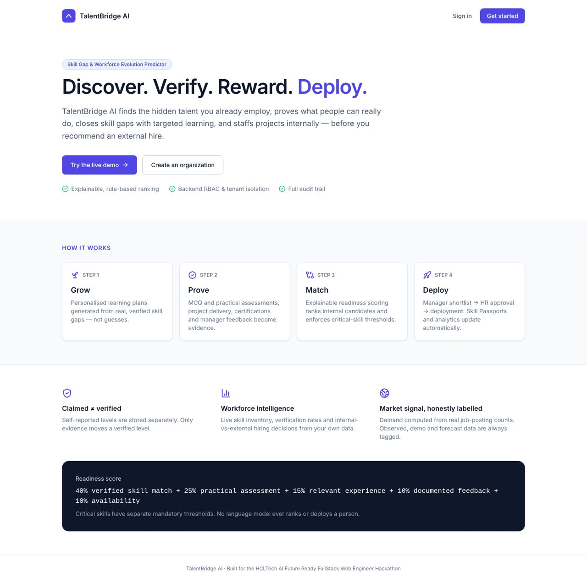

</div>

---

## Table of contents

1. [The problem](#1-the-problem)
2. [Our solution](#2-our-solution)
3. [Core differentiators](#3-core-differentiators)
4. [Product tour — screenshots](#4-product-tour)
5. [User roles & the 29 interfaces](#5-user-roles--the-29-interfaces)
6. [End-to-end workflow](#6-end-to-end-workflow)
7. [Technical architecture](#7-technical-architecture)
8. [AI & decision engines](#8-ai--decision-engines)
9. [Technology stack](#9-technology-stack)
10. [Installation & setup](#10-installation--setup)
11. [Demo accounts & demo scenario](#11-demo-accounts--demo-scenario)
12. [API documentation](#12-api-documentation)
13. [Data model](#13-data-model)
14. [Security & responsible AI](#14-security--responsible-ai)
15. [Testing](#15-testing)
16. [Implementation status](#16-implementation-status)
17. [Future scope](#17-future-scope)
18. [Project structure & further docs](#18-project-structure--further-docs)

---

## 1. The problem

Companies often hire externally for skills they already have:

- Employee skills are **self-reported** and rarely verified.
- Nobody has a reliable **internal skill inventory**.
- Hidden or under-used capabilities stay invisible.
- Project needs change faster than skill records.
- Upskilling is generic instead of targeted at real gaps.

## 2. Our solution

**TalentBridge AI** is a workforce intelligence platform that helps an organization **discover** internal talent, **verify** skills with evidence, **identify** skill gaps, **recommend** targeted upskilling and **match** verified people to projects — so external hiring becomes the last option, not the first.

> It is not a chatbot and not an employee directory. Every recommendation is computed from recorded evidence, explained component-by-component, and approved by a human.

---

## 3. Core differentiators

<table>
<tr>
<td width="50%" valign="top">

### 🔍 1. Discover internal talent
Skill Passports record claimed skills, experience, interests, availability and project history. The directory can filter by **verified** skill, which surfaces people outside the obvious team — e.g. a QA engineer whose assessments prove Advanced React.

</td>
<td width="50%" valign="top">

### ✅ 2. Evidence-based skill verification
`claimedLevel` and `verifiedLevel` are stored **separately**. Only evidence — MCQ and practical assessments, delivered projects, verified certifications, manager / team-lead ratings — moves a verified level. Each level shows its evidence trail and confidence.

</td>
</tr>
<tr>
<td valign="top">

### 🎯 3. Intelligent, explainable matching
Readiness = **40%** verified skill match + **25%** practical assessment + **15%** relevant experience + **10%** documented feedback + **10%** availability. Critical skills are **hard thresholds** a high score cannot override.

</td>
<td valign="top">

### 📉 4. Skill gap analysis
Per requirement: met, below level, claimed-but-unverified or missing — against any project, and against observed market demand.

</td>
</tr>
<tr>
<td valign="top">

### 🎓 5. Personalized learning
Plans are generated only from real gaps (current → target level), with official-documentation resources, level-based practical tasks and a reassessment that closes the plan automatically.

</td>
<td valign="top">

### 🌐 6. Market intelligence
Job-posting CSVs go through a pandas + spaCy pipeline. Demand = share of real postings mentioning a skill, compared with the organization's verified supply. Data is always labelled **Observed / Demo / Forecast**.

</td>
</tr>
<tr>
<td colspan="2" valign="top">

### 🧑‍⚖️ 7. Human-in-the-loop decisions
Engines rank and explain; people decide. A manager **shortlists**, HR **approves**, and only then is an employee deployed. Every step is audit-logged with before/after values. No language model ranks, scores or deploys anyone.

</td>
</tr>
</table>

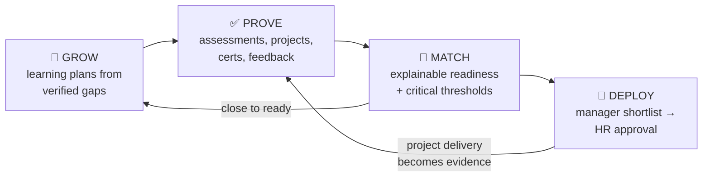

---

## 4. Product tour

> Screenshots were captured from the running application with the seeded demo organization (fictional company and people).

| AI Talent Matching & Candidate Comparison | Skill Passport (claimed vs verified) |
|---|---|
| 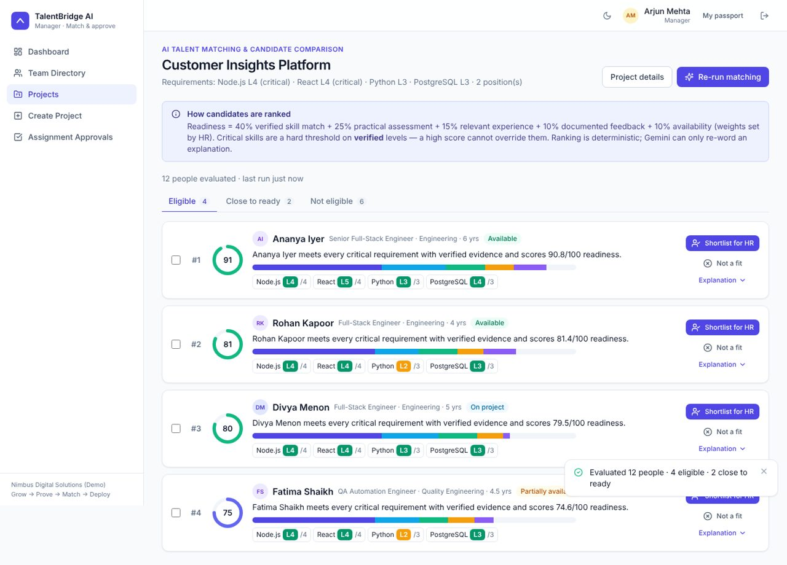 | 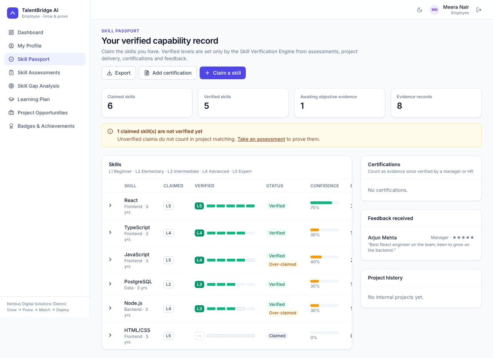 |
| **Skill Gap Analysis** | **Assessment Results & verification update** |
| 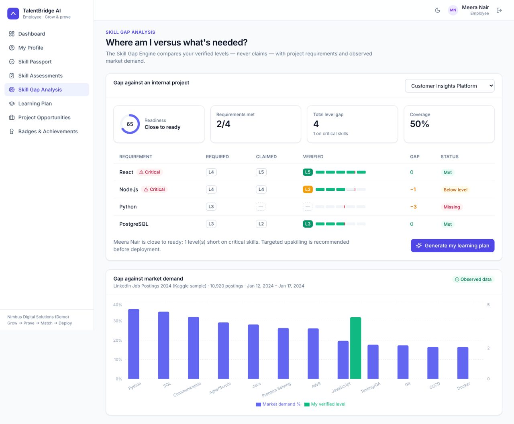 | 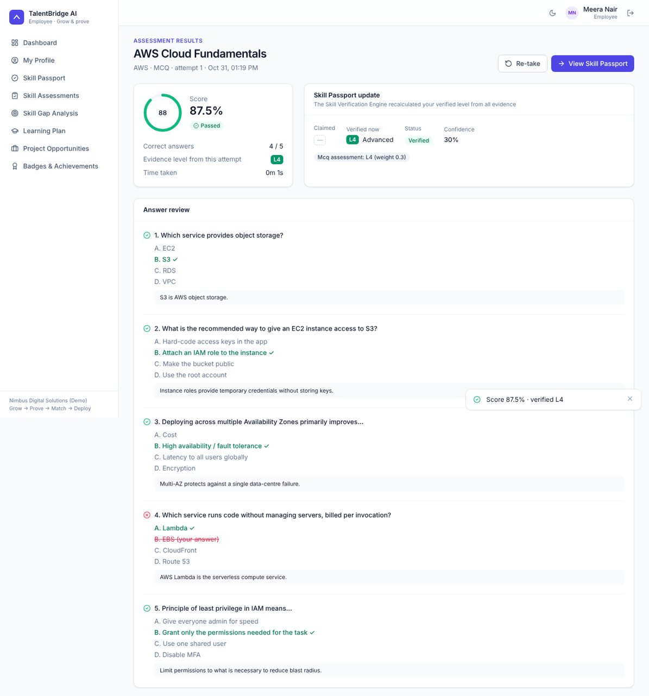 |
| **HR Dashboard** | **Manager Dashboard** |
| 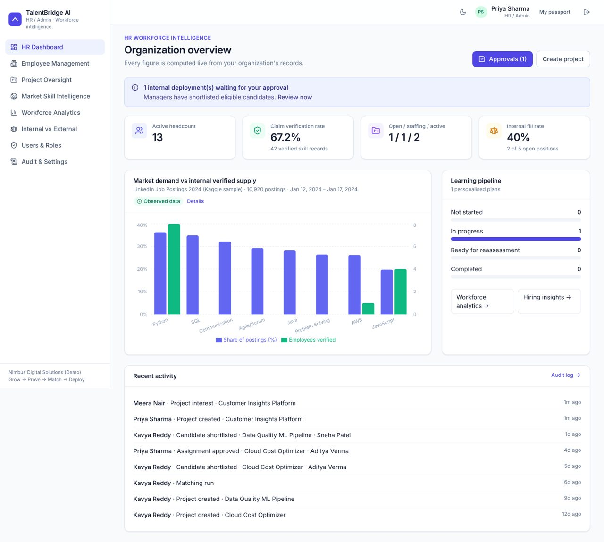 | 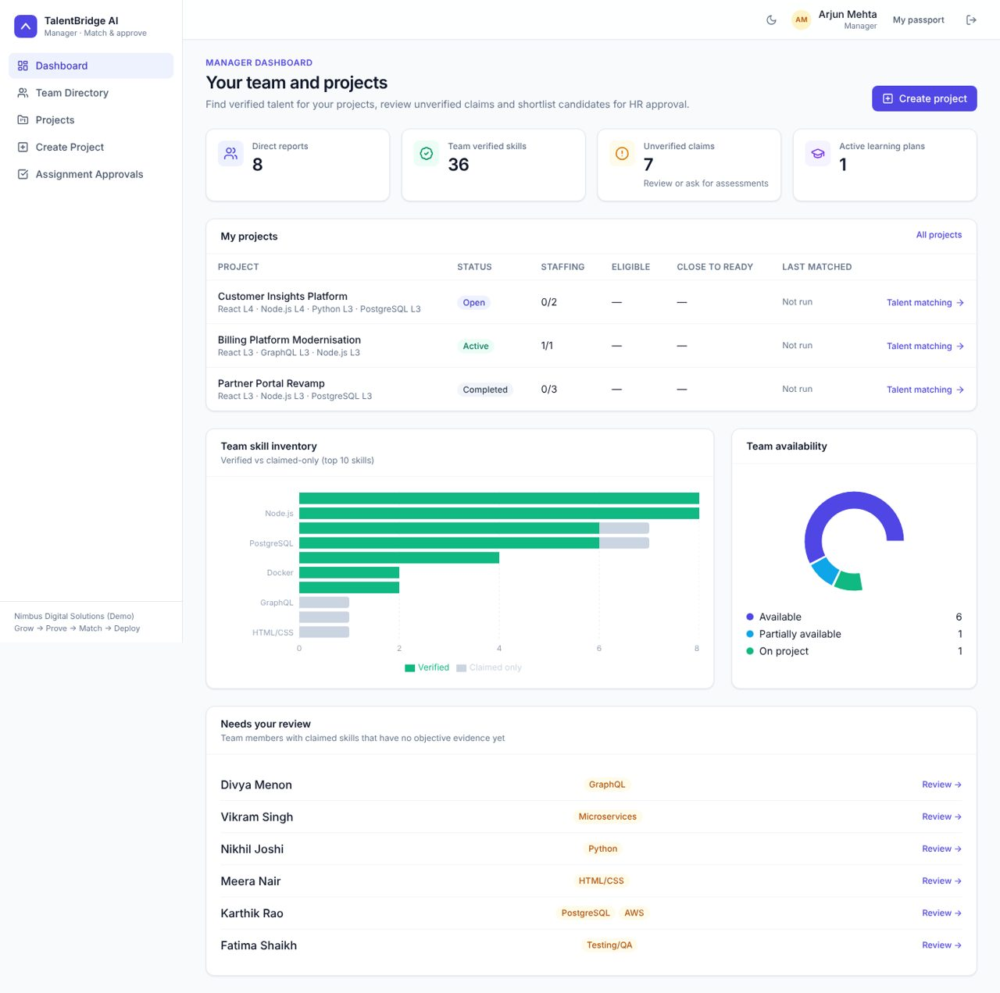 |
| **Market Skill Intelligence** | **Internal vs External Hiring Insights** |
| 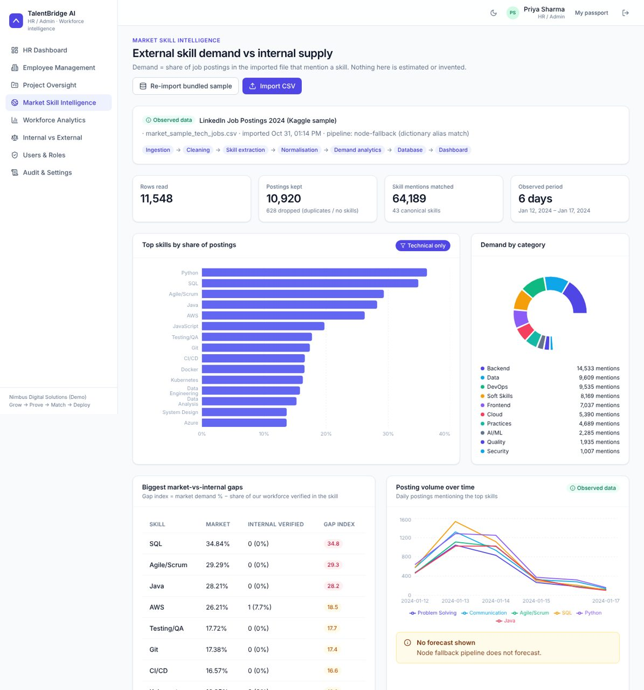 | 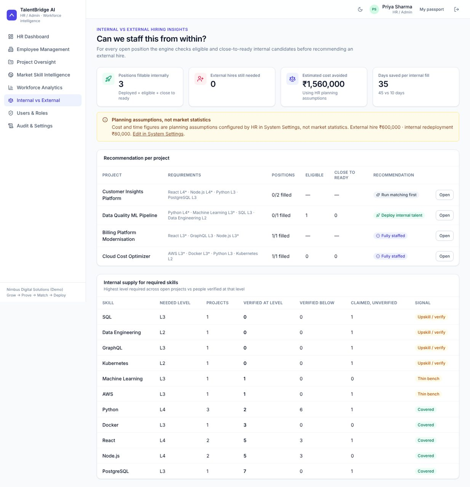 |
| **Workforce Analytics (dark theme)** | |
| 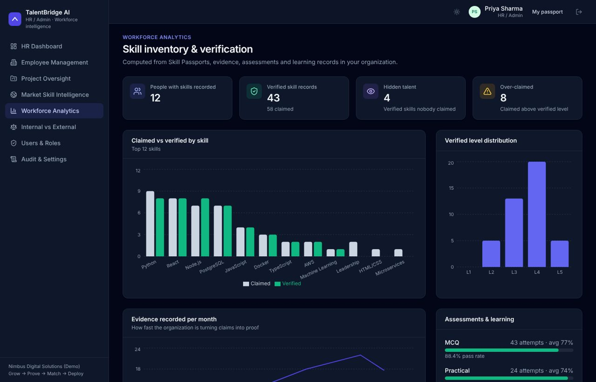 | |

---

## 5. User roles & the 29 interfaces

Each role has its **own layout, sidebar and dashboard**. Managers and HR also own a Skill Passport and can open the employee portal via *My passport*. Light/dark themes; responsive down to phone width.

<table>
<tr><th>👩‍💻 Employee — grow & prove</th><th>🧑‍💼 Manager — match & shortlist</th><th>🏢 HR / Admin — approve & govern</th></tr>
<tr valign="top">
<td>

4. Employee Dashboard
5. My Profile
6. Skill Passport
7. Skill Assessments
8. Take Assessment
9. Assessment Results
10. Skill Gap Analysis
11. Personalized Learning Plan
12. Internal Project Opportunities
13. Badges & Achievements

</td>
<td>

14. Manager Dashboard
15. Team Directory
16. Employee Details & Skill Review
17. Project List
18. Create / Edit Project
19. Project Details
20. AI Talent Matching & Candidate Comparison
21. Assignment Approvals

</td>
<td>

22. HR Dashboard
23. Employee Management
24. Project Oversight
25. Market Skill Intelligence
26. Workforce Analytics
27. Internal vs External Hiring Insights
28. User & Role Management
29. Audit Logs & System Settings

</td>
</tr>
<tr><td colspan="3"><b>Public:</b> 1. Landing Page · 2. Login (one-click demo accounts) · 3. Registration (join with code, or create an organization as HR)</td></tr>
</table>

**Highlights by role**

| Role | What they can do |
|---|---|
| Employee | Claim skills, take timed MCQ / practical assessments graded on the server, see the verified level and evidence breakdown, analyse gaps vs projects and market demand, follow learning plans, see live readiness for open projects and express interest, earn badges for *verified* growth |
| Manager | Search people by verified skill, record manager / team-lead feedback with skill ratings, verify certifications, create projects with level thresholds, run matching, compare 2–4 candidates (radar + table), shortlist eligible people, assign learning to close-to-ready people, mark assignments delivered |
| HR / Admin | Create organizations / people / departments, oversee all projects, **approve deployments**, import job-posting CSVs, view workforce and hiring analytics, manage roles and accounts, tune matching weights and hiring assumptions, browse the audit log |

Route map: [docs/SCREENS.md](docs/SCREENS.md).

---

## 6. End-to-end workflow

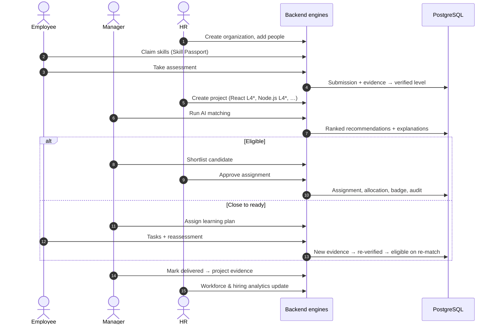

Step-by-step mapping to screens and endpoints: [docs/WORKFLOW.md](docs/WORKFLOW.md).

---

## 7. Technical architecture

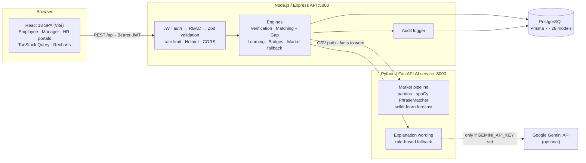

**Design rules enforced in code**

- **Deterministic decisions, optional language.** Levels, scores, eligibility, ranking and deployment are computed in the Node engines. Gemini is called only by the AI service, only to *re-word* explanations built from those facts, only if a key is configured, and HR can switch it off.
- **Graceful degradation.** Every AI-service call has a timeout. If it is offline, the backend uses a Node market pipeline and rule-based text, and labels which one ran.
- **No invented numbers.** Market demand comes from posting counts in the imported file. Hiring cost/time figures are HR-entered *assumptions* and labelled as such.

More detail: [docs/ARCHITECTURE.md](docs/ARCHITECTURE.md).

---

## 8. AI & decision engines

| Module | Purpose | Input | Processing | Output | Technology |
|---|---|---|---|---|---|
| **Skill extraction & normalisation** | Turn free-text job skills into canonical skills | Job-posting CSV (`job_title`, `job_skills`, optional id/company/date/level/type) | Chunked read, trim, drop empty, de-duplicate by posting id; spaCy `PhraseMatcher` over a curated dictionary (43 skills, aliases), whole-token rule for ambiguous aliases, title scan | Normalised postings, unmatched-term list | Python, pandas, spaCy (`spacy.blank("en")`), `shared/skill_dictionary.json`; Node fallback in `engines/market.js` |
| **Skill verification** | Convert evidence into a verified level | Latest evidence per type for one employee + skill | Weighted mean — practical 0.35, MCQ 0.30, project 0.15, manager 0.10, team lead 0.05, certification 0.05; capped at best objective level + 1; VERIFIED only with an MCQ/practical result | `verifiedLevel` (1–5), status, confidence, stored breakdown | `backend/src/engines/verification.js` |
| **Explainable talent matching** | Rank internal candidates for a project | Project requirements (level, critical flag, weight), every active passport, evidence, feedback, assignments, availability | 5-component readiness score (weights editable by HR, must total 100); critical skills as mandatory thresholds; tiering eligible → close to ready → others | Ranked recommendations with summary, strengths, concerns, blockers, per-skill gap and each component's contribution | `backend/src/engines/matching.js` |
| **Skill-gap analysis** | Show exactly what is missing | Verified passport + requirements, or latest market demand | Per requirement: MET / BELOW / UNVERIFIED / MISSING; critical gap levels; coverage | Gap table, readiness, market-gap chart | `computeGap()` in `matching.js`, `GET /api/me/gap` |
| **Personalized learning** | Close real gaps | Gaps (`verified < required`), project context | One plan per skill: current → target level, priority from criticality, official-doc resources, level-templated tasks; reassessment reaching target completes the plan | Learning plan, progress log, badge | `backend/src/engines/learning.js`; optional Gemini wording via `/explain/learning` |
| **Market intelligence** | Compare external demand with internal supply | Normalised postings | Demand % = postings mentioning skill / postings kept; senior share; daily counts; weekly linear-trend forecast **only with ≥ 8 weeks** of dated data | Demand table, gap index vs verified workforce, trend, forecast note | `ai-service/app/market.py` (pandas, scikit-learn `LinearRegression`), stored in 5 market tables |

**Bundled market data.** `data/market_sample_tech_jobs.csv` is an 11,548-row tech-role sample of the public Kaggle *LinkedIn Jobs & Skills 2024* dataset (postings first seen 12–17 Jan 2024). It is labelled **Observed**. Because it spans only 6 days, the app shows *why* no forecast is produced instead of extrapolating.

---

## 9. Technology stack

| Layer | Technologies (versions from `package.json` / `requirements.txt`) |
|---|---|
| **Frontend** | React 18.3, Vite 5.4, Tailwind CSS 3.4, React Router 6.28, TanStack React Query 5.62, Axios 1.7, Recharts 2.15, Lucide React 0.468, Framer Motion 11.15 |
| **Backend** | Node.js ≥ 20.19, Express 4.21, jsonwebtoken 9, bcryptjs 2.4, Zod 3.23, Helmet 8, cors, express-rate-limit 7, multer (CSV upload), morgan, express-async-errors |
| **Database** | PostgreSQL 14+, Prisma ORM 7.10 with `@prisma/adapter-pg` / `pg`, SQL migration in `backend/prisma/migrations` |
| **AI / ML** | Python 3.10+, FastAPI, Uvicorn, pandas, NumPy, spaCy, scikit-learn, httpx, python-dotenv |
| **APIs & integrations** | Internal REST API (`/api`), internal AI-service REST API (`:8000`), Google Gemini `generateContent` REST API (optional) |
| **Testing & tooling** | Node built-in test runner (`node:test`) end-to-end suite, nodemon, Mermaid docs, Windows launcher `RUN-TalentBridge.bat`, `scripts/start-windows.bat`, `scripts/start.sh` |

---

## 10. Installation & setup

### Prerequisites

| Tool | Version |
|---|---|
| Node.js | **20.19 or newer** (22 LTS recommended) — required by Prisma 7 |
| Python | 3.10+ (optional: without it the app uses its Node fallbacks) |
| PostgreSQL | 14+ running locally |
| Git | any |

### Option A — one click (Windows)

Double-click **`RUN-TalentBridge.bat`** in the project root. It checks Node/Python, installs packages, generates the Prisma client, creates the database if needed, applies migrations, creates the Python virtual environment, starts the AI service, seeds demo data, starts the API and web app in separate windows, and opens `http://localhost:5173/login`.
If the database already holds tables from an older version, it asks before dropping them.

### Option B — manual (Windows / macOS / Linux)

```bash
# 1. Clone
git clone https://github.com/un096/Hackathon.git
cd Hackathon
```

**2. Backend API** (terminal 1)

```bash
cd backend
cp .env.example .env            # Windows: copy .env.example .env
#   edit .env → DATABASE_URL, JWT_SECRET (32+ random characters)
npm install
npx prisma generate
node scripts/db-init.js         # creates the database if missing (optional helper)
npx prisma migrate deploy       # creates all tables
npm run dev                     # http://localhost:5000/api/health
```

**3. AI service** (terminal 2, optional but recommended)

```bash
cd ai-service
python -m venv .venv
.venv\Scripts\activate          # macOS/Linux: source .venv/bin/activate
pip install -r requirements.txt
cp .env.example .env            # Windows: copy …  — optionally add GEMINI_API_KEY
python run.py                   # http://localhost:8000/health
```

**4. Seed demo data** (terminal 1 or 3, after the AI service is up so the spaCy pipeline is used)

```bash
cd backend
npm run db:seed                 # resets data, ~15–30 s
```

**5. Frontend** (terminal 3)

```bash
cd frontend
npm install
npm run dev                     # http://localhost:5173  (Vite proxies /api → :5000)
```

After the first setup, `scripts/start-windows.bat` (Windows) or `scripts/start.sh` (macOS/Linux) starts all three services.

### Environment variables

| File | Variable | Required | Purpose |
|---|---|---|---|
| `backend/.env` | `DATABASE_URL` | ✅ | PostgreSQL connection string |
| | `JWT_SECRET` | ✅ | Token signing secret (≥ 32 chars; enforced in production) |
| | `JWT_EXPIRES_IN` | | Default `8h` |
| | `PORT` / `NODE_ENV` | | Default `5000` / `development` |
| | `FRONTEND_URL` | | Allowed CORS origin(s), comma-separated |
| | `AI_SERVICE_URL` / `AI_SERVICE_TOKEN` | | AI service address and optional shared secret |
| `ai-service/.env` | `GEMINI_API_KEY` / `GEMINI_MODEL` | | Enables Gemini wording (default model `gemini-2.0-flash`) |
| | `AI_HOST` / `AI_PORT` / `AI_SERVICE_TOKEN` | | Bind address (default `127.0.0.1:8000`) and shared secret |
| | `MARKET_ALLOWED_DIRS` | | Directories the pipeline may read CSVs from |
| `frontend/.env` | `VITE_API_URL` / `VITE_API_PROXY` | | Only needed if the API is not on `localhost:5000` |

> Never commit `.env` files — they are git-ignored. API keys stay on the server; the Gemini key is never sent to the browser.

### Useful backend scripts

| Script | Does |
|---|---|
| `npm run dev` / `npm start` | Start API with / without auto-reload |
| `npm run db:migrate` | `prisma migrate deploy` |
| `npm run db:seed` | Reset data and seed the demo organization + market sample |
| `npm run db:reset` | Drop schema, re-apply migrations, seed |
| `npm run setup` | Generate client + migrate + seed |
| `npm run test:e2e` | End-to-end test suite (API must be running) |

---

## 11. Demo accounts & demo scenario

Password for every demo account: **`Demo@1234`** (one-click buttons on the login page). The organization *Nimbus Digital Solutions (Demo)* and all people are fictional.

| Role | Email |
|---|---|
| HR / Admin | `hr@talentbridge.demo` |
| Manager (Engineering) | `manager@talentbridge.demo` |
| Manager (Data & Cloud) | `manager2@talentbridge.demo` |
| Employee (Meera Nair) | `employee@talentbridge.demo` |

Registration join code: **`NIMBUS24`**.

**Seeded scenario** — 13 users, 5 departments, 14 assessments, 5 projects. The demo project *Customer Insights Platform* needs **React L4 (critical), Node.js L4 (critical), Python L3, PostgreSQL L3**. Running matching on the seed gives:

| Outcome | Who | Why it matters |
|---|---|---|
| Ranked #1, eligible | Ananya Iyer | Every critical skill verified; full explanation |
| Eligible — **hidden talent** | Fatima Shaikh | QA engineer who never claimed React/Node; assessments verify L4 |
| **Close to ready** despite high score | Vikram Singh, Meera Nair | One critical skill a level short → learning plan, not rejection |
| Not eligible | Karthik Rao | Claims L5, evidence says L3/L2 — claims never count |

After Meera completes a Node.js practical reassessment, re-matching moves her into the eligible list (covered by the e2e tests). Full 7-minute script: [docs/DEMO_SCRIPT.md](docs/DEMO_SCRIPT.md).

---

## 12. API documentation

Base URL `http://localhost:5000/api` · JSON · authenticated routes need `Authorization: Bearer <token>`.
55 endpoints in total. Full list: [docs/API.md](docs/API.md).

**Roles:** E = employee · M = manager · H = HR. Every account also has a Skill Passport, so `/me/*` works for all roles.

| Area | Method & path | Role | Purpose |
|---|---|---|---|
| Health | `GET /health` | public | API + DB status |
| Auth | `POST /auth/register` · `POST /auth/login` · `GET /auth/me` | public / any | Join with code or create org (HR); JWT login (rate limited) |
| Skill Passport | `GET /me/passport` · `POST /me/skills` · `POST /me/certifications` | any | Claims, evidence, certifications |
| Assessments | `GET /assessments` · `GET /assessments/:id/start` · `POST /assessments/:id/submit` · `GET /assessments/submissions/:id` | any | Questions without answer keys; server-side grading → evidence → verification |
| Gap & learning | `GET /me/gap?projectId=` · `POST /me/learning/generate` · `PATCH /me/learning/:id/tasks/:taskId` | any | Gap analysis, plans, task progress |
| Opportunities | `GET /me/opportunities` · `POST /me/opportunities/:projectId/interest` | any | Live readiness per open project |
| People | `GET /employees` · `GET /employees/:id` · `POST /employees/:id/feedback` · `POST /employees/:id/certifications/:certId/verify` | M, H | Directory, review, feedback, cert verification |
| People admin | `POST /employees` · `PUT /employees/:id` | H | Create / update people |
| Projects | `GET/POST /projects` · `GET/PUT /projects/:id` | M, H | Projects and requirements |
| Matching | `POST /projects/:id/match` · `GET /projects/:id/recommendations` · `GET /projects/:id/compare` · `GET /projects/:id/recommendations/:recId/narrative` | M, H | Run engine, ranked results, comparison, optional wording |
| Decisions | `POST /projects/:id/recommendations/:recId/shortlist` · `…/reject` · `…/learning` | M, H | Shortlist eligible, reject, assign learning |
| Approvals | `GET /approvals` · `POST /approvals/:recId/approve` · `POST /approvals/:recId/reject` | M, H (approve: **H only**) | Deploy or reject |
| Delivery | `POST /projects/:id/assignments/:assignmentId/complete` | M, H | Project evidence → re-verification |
| Insights | `GET /manager/dashboard` · `GET /hr/dashboard` · `GET /analytics/workforce` · `GET /analytics/hiring` | M/H | Dashboards and analytics |
| Market | `GET /market/summary` · `GET /market/runs` · `POST /market/import` · `POST /market/import-sample` | any / H | Demand vs supply, CSV import |
| Admin | `/admin/users`, `/admin/audit`, `/admin/settings`, `/admin/departments`, … | H | Roles, audit log, settings |

<details>
<summary><b>Example — log in</b></summary>

```http
POST /api/auth/login
Content-Type: application/json

{ "email": "hr@talentbridge.demo", "password": "Demo@1234" }
```

```json
{
  "success": true,
  "token": "<JWT>",
  "user": {
    "id": "…", "email": "hr@talentbridge.demo", "role": "HR",
    "firstName": "Priya", "lastName": "Sharma",
    "organizationId": "…", "employeeId": "…",
    "organizationName": "Nimbus Digital Solutions (Demo)"
  }
}
```
</details>

<details>
<summary><b>Example — create a project</b></summary>

```http
POST /api/projects
Authorization: Bearer <JWT>
Content-Type: application/json

{
  "title": "Customer Analytics Portal",
  "openPositions": 2,
  "minExperience": 3,
  "requirements": [
    { "skillId": "<React id>",      "minLevel": 4, "isCritical": true,  "weight": 1.5 },
    { "skillId": "<Node.js id>",    "minLevel": 4, "isCritical": true,  "weight": 1.5 },
    { "skillId": "<Python id>",     "minLevel": 3, "isCritical": false, "weight": 1 },
    { "skillId": "<PostgreSQL id>", "minLevel": 3, "isCritical": false, "weight": 1 }
  ]
}
```
Skill ids come from `GET /api/skills`. Response: `201 { "success": true, "data": { "id": "…", … } }`.
</details>

<details>
<summary><b>Example — run matching and read one recommendation</b></summary>

```http
POST /api/projects/:id/match          →  { "success": true, "data": { "evaluated": 12, "eligible": 4, "nearlyReady": 2 } }
GET  /api/projects/:id/recommendations
```

```json
{
  "rank": 1, "readinessScore": 90.8, "eligible": true, "nearlyReady": false, "status": "RECOMMENDED",
  "skillMatchScore": 100, "practicalScore": 79, "experienceScore": 80, "feedbackScore": 90, "availabilityScore": 100,
  "explanation": {
    "summary": "Ananya Iyer meets every critical requirement with verified evidence and scores 90.8/100 readiness.",
    "strengths": ["React: verified L5 (Expert) meets required L4", "…"],
    "concerns": [], "blockers": [],
    "gap": [{ "skillName": "Node.js", "required": 4, "verified": 4, "claimed": 4, "critical": true, "state": "MET" }],
    "components": { "skillMatch": { "score": 100, "weight": 40, "contribution": 40 }, "…": "…" },
    "method": "deterministic-weighted-v1"
  }
}
```
Values shown are from the seeded demo data.
</details>

**Errors:** `{ "success": false, "message": "…", "details": [...] }` — 400 validation, 401 not authenticated, 403 wrong role, 404 not found *or another organization's record*, 409 conflict.

---

## 13. Data model

PostgreSQL, **28 Prisma models**, one migration (`backend/prisma/migrations/20261031000000_init`). Groups: tenancy & people · skills taxonomy · Skill Passport & evidence · assessments · projects, recommendations & assignments · learning & badges · market intelligence · audit log.

ER diagram: [docs/er-diagram.svg](docs/er-diagram.svg) · details: [docs/DATABASE.md](docs/DATABASE.md).

---

## 14. Security & responsible AI

### Implemented

| Safeguard | How |
|---|---|
| Password security | bcrypt hashing (bcryptjs, cost 12); password policy (≥ 8 chars, letter + number); hashes never returned by the API |
| Authentication | JWT (default 8 h). The user is **re-loaded from the database on every request**, so deactivation and role changes apply immediately |
| Role-based access control | `authorize(...)` middleware on every router plus ownership checks (project manager, own assessment results). Frontend route guards are UX only |
| Organization isolation | Every query is scoped by the authenticated user's `organizationId`; cross-tenant ids return 404 (verified by tests) |
| Input validation | Zod schemas for bodies and queries; Prisma parameterised queries |
| Abuse protection | Rate-limited login/registration; same error for unknown email and wrong password; Helmet headers; CORS restricted to `FRONTEND_URL` |
| Secrets | Only in `.env`; Gemini key held by the AI service and never sent to clients |
| Uploads | `.csv` only, 50 MB limit, temp file deleted after processing; AI service reads only paths inside allowed directories |
| Assessment integrity | Answer keys never leave the server before submission; grading server-side; practical items are controlled scenarios — **no untrusted code is executed** |
| Evidence-backed evaluation | Claims and verified levels kept separate; verification requires objective evidence; breakdown stored and shown |
| Explainability | Every recommendation stores component scores, strengths, concerns, blockers and per-skill gap |
| Human approval | Manager shortlist → HR approval → deployment; ineligible candidates cannot be shortlisted; LLM never ranks or decides |
| Honest data labelling | Observed / Demo / Forecast tags; forecasts only with sufficient history; hiring costs labelled as assumptions |
| Accountability | Audit log with user, IP, before/after JSON for logins, claims, assessments, feedback, projects, matching, shortlists, approvals, settings, role changes, imports |

### Not yet implemented (planned)

- Refresh tokens / httpOnly cookies (the JWT is currently kept in `localStorage`) and forced password change after a temporary password.
- Encryption of sensitive fields at rest, data-retention policies, consent management.
- Sandboxed live-coding assessments.
- Bias / fairness monitoring of matching outcomes.

---

## 15. Testing

| Type | Status | Location |
|---|---|---|
| End-to-end API workflow tests | ✅ 13 tests (Node `node:test`) | `backend/tests/e2e.test.js` |
| Unit tests | ❌ not yet | — |
| Frontend tests | ❌ not yet | — |
| CI pipeline | ❌ not yet | — |

The e2e suite covers: login for all roles · RBAC denials · validation errors · project creation · matching ranks and thresholds (hidden talent, close to ready, over-claiming, thresholds beating raw score, components summing to readiness) · learning assignment · answer keys hidden + server-side grading · reassessment closing a learning plan · re-matching · shortlist → HR-only approval → deployment and badge · delivery writing project evidence · market CSV import and demand counts · tenant isolation · audit coverage.

```bash
cd backend
npm run db:seed        # fresh demo data
npm run dev            # keep the API running
npm run test:e2e       # in a second terminal
```

> The suite changes data (creates a project, deploys an employee, imports a small CSV). Re-run `npm run db:seed` before a demo.

---

## 16. Implementation status

| Feature | Status | Notes |
|---|---|---|
| 29 screens, 3 role portals, light/dark, responsive | ✅ Implemented | |
| Auth, RBAC, tenant isolation, audit log | ✅ Implemented | |
| Skill Passport, claims vs verified, evidence trail | ✅ Implemented | |
| MCQ + practical assessments, server-side grading | ✅ Implemented | 14 assessments covering 10 skills |
| Verification engine (6 evidence types) | ✅ Implemented | |
| Explainable matching with thresholds, comparison | ✅ Implemented | Weights editable by HR |
| Gap analysis, learning plans, reassessment loop | ✅ Implemented | |
| Manager shortlist → HR approval → deployment | ✅ Implemented | |
| Badges & points for verified growth | ✅ Implemented | 7 badges |
| Workforce analytics, hiring insights | ✅ Implemented | Costs use HR-entered assumptions |
| Market CSV pipeline (pandas + spaCy) + Node fallback | ✅ Implemented | Dictionary-based extraction (43 skills) |
| Market demand forecasting | 🟡 Partial | Implemented, but only runs with ≥ 8 weeks of dated postings; the bundled sample (6 days) does not trigger it |
| Gemini-worded explanations | 🟡 Partial | Implemented and optional; tested with the rule-based fallback only — no API key was used during development |
| Practical assessments | 🟡 Partial | Controlled code-reading / debugging scenarios, not live coding |
| Notifications (email/Slack), HR assessment authoring UI, unit/frontend tests, CI, containerisation | ⏳ Planned | See below |

---

## 17. Future scope

- Sandboxed live-coding assessments and randomised question pools; HR authoring UI.
- Embedding / NER-based skill extraction to raise recall beyond the curated dictionary.
- Longer market histories to enable forecasting; scheduled market refresh.
- Email / chat notifications for shortlists and approvals.
- Refresh-token sessions, field-level encryption, retention policies, fairness monitoring.
- Background job queue for matching at large scale.
- Docker Compose deployment, CI with unit and frontend tests.

Known limitations: [docs/LIMITATIONS.md](docs/LIMITATIONS.md).

---

## 18. Project structure & further docs

```
├── backend/                 Express API
│   ├── prisma/              schema.prisma · migrations/ · seed.js · data/assessments.js
│   ├── scripts/             db-init.js · wait-for.js
│   ├── src/engines/         verification · matching (+gap) · learning · badges · market
│   ├── src/routes/          auth · me · assessments · employees · projects · approvals · market · insights · admin · skills
│   ├── src/middleware/      auth (JWT + RBAC) · validate (Zod) · error
│   ├── src/lib/             prisma · audit · settings · dictionary · aiClient · queries
│   └── tests/e2e.test.js
├── ai-service/              FastAPI: app/market.py · app/skills.py · app/explain.py · app/main.py · run.py
├── frontend/src/            pages/{public,employee,manager,hr} · components · lib
├── shared/                  skill_dictionary.json (skills, aliases, learning resources)
├── data/                    market_sample_tech_jobs.csv (observed public data sample)
├── docs/                    architecture · API · database · workflow · screens · demo script · limitations · screenshots
├── scripts/                 start-windows.bat · start.sh
└── RUN-TalentBridge.bat     one-click Windows setup & run
```

| Document | Contents |
|---|---|
| [docs/ARCHITECTURE.md](docs/ARCHITECTURE.md) | System design, engine formulas, security model |
| [docs/API.md](docs/API.md) | All endpoints with role and purpose |
| [docs/DATABASE.md](docs/DATABASE.md) | Models, tenant isolation, ER diagram |
| [docs/WORKFLOW.md](docs/WORKFLOW.md) | Workflow → screens → APIs → database changes |
| [docs/SCREENS.md](docs/SCREENS.md) | The 29 screens and routes |
| [docs/DEMO_SCRIPT.md](docs/DEMO_SCRIPT.md) | Judging walkthrough |
| [docs/LIMITATIONS.md](docs/LIMITATIONS.md) | Known limitations |
| [CONTRIBUTING.md](CONTRIBUTING.md) | Team workflow and coding conventions |

---

<div align="center">

### Why TalentBridge AI is different

**A chatbot answers questions. An HR system stores records.**
TalentBridge AI **proves** what people can do, **explains** every match, **grows** the people who are almost ready, and lets humans **decide** — so the next project is staffed from within.

**Grow → Prove → Match → Deploy**

<sub>Built for the HCLTech AI Future Ready FullStack Web Engineer Hackathon.</sub>

</div>
