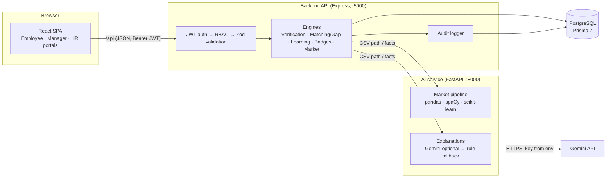

# Architecture

## Design principles

1. **Deterministic decisions, optional language.** Levels, scores, rankings, eligibility and deployments are computed in code from database rows. Gemini (through the AI service) can only re-word an explanation built from those facts; it is off when no key is configured and can be disabled by HR.
2. **Claimed ≠ verified.** `EmployeeSkill.claimedLevel` is self-reported; `verifiedLevel` is written only by the verification engine.
3. **Never block the demo.** Every call to the AI service has a timeout and a deterministic fallback (Node market pipeline, rule-based text).
4. **Never invent numbers.** Market demand is posting counts from an imported file. Hiring cost/time figures are HR-configured *assumptions*, labelled as such. Forecasts are only produced with ≥ 8 weeks of dated postings.

## Engines

### Skill Verification Engine — `backend/src/engines/verification.js`
| Evidence | Weight | Level source |
|---|---|---|
| Practical assessment | 0.35 | score → level (≥90 L5, ≥75 L4, ≥60 L3, ≥40 L2, else L1) |
| MCQ assessment | 0.30 | same mapping, capped at L4 |
| Internal project delivery | 0.15 | level used on a completed assignment |
| Manager feedback | 0.10 | manager's skill rating |
| Team-lead feedback | 0.05 | team lead's skill rating |
| Verified certification | 0.05 | level set by the verifier (default L3) |

Latest evidence per type counts. `verifiedLevel = round(weighted mean)`, capped at *best objective level + 1*. Status is **VERIFIED** only with at least one objective (MCQ/practical) result, otherwise **IN_REVIEW**. `confidence` = sum of weights present. The breakdown is stored in `verificationNotes` and shown in the UI.

### Talent Matching Engine — `backend/src/engines/matching.js`
`Readiness = 40% skill match + 25% practical + 15% experience + 10% feedback + 10% availability` (weights editable by HR, must total 100).

- **Skill match:** Σ wᵢ·min(verifiedᵢ / requiredᵢ, 1) / Σ wᵢ, with wᵢ = requirement weight × 1.5 for critical skills. Claims score 0.
- **Practical:** mean of latest practical score per required skill (missing = 0).
- **Experience:** 60 × min(years / minExperience, 1) + 40 × share of required skills used on past internal projects.
- **Feedback:** mean skill-specific ratings for required skills (else overall rating) / 5.
- **Availability:** Available 100 · Partially available 100 − allocation% · On project 20 · On leave 0.
- **Mandatory thresholds:** every critical requirement needs *verified* level ≥ required. Failing candidates are **not eligible** whatever their score; those within `nearlyReadyMaxGap` (default 2) critical levels and ≥ 50 skill match are **close to ready** and get learning plans.
- Ordering: eligible → close to ready → others, then readiness. Every recommendation stores summary, strengths, concerns, blockers, per-skill gap and each component's contribution.

### Skill Gap Engine
`computeGap()` returns per-requirement *MET / BELOW / UNVERIFIED / MISSING*, critical gaps, coverage and level totals. Used by matching, employee gap analysis, opportunities and learning.

### Learning Recommendation Engine — `engines/learning.js`
One plan per gap (`verified < required`): current/target level, priority from criticality, official-documentation resources from `shared/skill_dictionary.json`, level-templated practical tasks, progress log. Completing all tasks → *Ready for reassessment*; an assessment that verifies the target level → *Completed* + "Gap Closer" badge.

### Market Intelligence Engine — `ai-service/app/market.py` (+ `engines/market.js` fallback)
Ingestion (chunked `pandas.read_csv`) → cleaning (trim, drop empty, de-duplicate by posting id) → extraction (spaCy `PhraseMatcher` over a curated dictionary of 43 skills / 200+ aliases, whole-token rules for ambiguous aliases, title scan) → normalisation to canonical skills → demand (`postings mentioning skill / postings kept`, senior share) → Postgres (`MarketDataRun`, `MarketJobPosting`, `MarketJobSkill`, `MarketSkillDemand`, `MarketSkillTrend`) → dashboard. Weekly linear-trend forecast (scikit-learn) only with ≥ 8 weeks of history; otherwise the reason is stored and shown. Unmatched frequent terms are surfaced for dictionary curation.

## Security model

| Concern | Implementation |
|---|---|
| Passwords | bcrypt (bcryptjs, cost 12); password policy via Zod |
| Authentication | JWT (HS256, 8 h). On every request the user is re-loaded from the DB, so role changes and deactivation take effect immediately |
| Authorization | `authorize(...roles)` middleware on every router; ownership checks (project manager, own submissions) in handlers. Frontend guards are UX only |
| Tenant isolation | Every query is scoped by `organizationId` from the verified user; cross-org IDs return 404 (tested) |
| Input validation | Zod schemas for bodies/queries; Prisma parameterised queries |
| Brute force | `express-rate-limit` on login/register; generic login error (no account enumeration) |
| Headers / CORS | Helmet; CORS restricted to `FRONTEND_URL` |
| Secrets | Only in `.env`; Gemini key lives in the AI service and is never returned to clients |
| Uploads | CSV only, 50 MB max, temp file deleted after processing; AI service only reads paths inside allowed directories |
| Assessments | Answer keys never leave the server before submission; grading server-side; practical items are controlled scenarios — no code execution |
| Audit | `AuditLog` with before/after JSON for logins, claims, assessments, feedback, projects, matching, shortlists, approvals, settings, role changes, imports |
