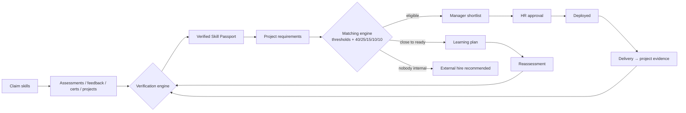

# End-to-end workflow

| # | Step | Who | Screen | API | What changes in the database |
|---|---|---|---|---|---|
| 1 | Create organization | HR | Registration (create) | `POST /auth/register` | Organization + HR user + join code |
| 2 | Add employees & managers | HR | Employee Management | `POST /employees` | User + Employee, temp password |
| 3 | Employee registers | Employee | Registration (join) | `POST /auth/register` | User + Employee in that org |
| 4 | Build Skill Passport, claim skills | Employee | Skill Passport | `POST /me/skills` | EmployeeSkill (CLAIMED) |
| 5 | Take technical assessment | Employee | Assessments → Take → Results | `POST /assessments/:id/submit` | Submission + SkillEvidence |
| 6 | Verification engine assigns proficiency | System | Results, Passport | (inside submit / feedback / cert / delivery) | EmployeeSkill.verifiedLevel, status, confidence, breakdown; badges |
| 7 | Manager feedback / certification check | Manager | Employee Details & Skill Review | `POST /employees/:id/feedback`, `…/verify` | Evidence → re-verification |
| 8 | Create project requirements | HR / Manager | Create/Edit Project | `POST /projects` | Project + requirements |
| 9 | AI talent matching | Manager | AI Talent Matching | `POST /projects/:id/match` | ProjectRecommendation rows with scores + explanation |
| 10 | Skill gap engine | System | Matching (explanation), Gap Analysis | `GET /me/gap` | — |
| 11 | Learning recommendations | Manager / Employee | Matching → *Assign learning*, Learning Plan | `POST …/learning`, `POST /me/learning/generate` | LearningRecommendation |
| 12 | Learning + reassessment | Employee | Learning Plan → Take Assessment | `PATCH …/tasks`, submit | Progress, new evidence, plan COMPLETED, badge |
| 13 | Re-match & compare | Manager | Matching, comparison | `POST /match`, `GET /compare` | Updated recommendations |
| 14 | Manager shortlists | Manager | Matching | `POST …/shortlist` | Recommendation → SHORTLISTED |
| 15 | HR approves | HR | Assignment Approvals | `POST /approvals/:id/approve` | ProjectAssignment, allocation, availability, project status, DEPLOYED badge |
| 16 | Project delivered | Manager | Project Details | `POST …/assignments/:id/complete` | PROJECT evidence → Skill Passport re-verified, allocation released |
| 17 | Workforce intelligence updates | HR | HR Dashboard, Workforce Analytics, Hiring Insights, Market | `GET /hr/dashboard`, `/analytics/*`, `/market/summary` | Read-only, live aggregates |

Every step writes an `AuditLog` record (Audit Logs screen).

